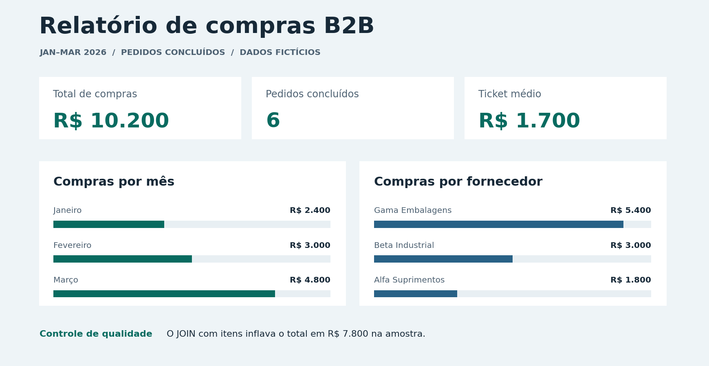

# Relatório de compras B2B

Estudo de caso de SQL Server com dados fictícios. O objetivo é medir compras concluídas e mostrar como um relacionamento entre pedidos e itens pode inflar um relatório.

## O problema

O valor total está no cabeçalho do pedido. Ao juntar pedidos e itens, esse valor se repete a cada linha de item. Na amostra, o pedido 104 tem três itens e vale R$ 2.400,00. Somar o cabeçalho depois do JOIN faz esse pedido aparecer como R$ 7.200,00.

A consulta corrigida calcula os indicadores na tabela de pedidos, com uma linha por pedido, e considera somente o status `Concluido`. Os pedidos 101 e 102 têm o mesmo valor e ambos entram no total. Por isso, somar valores distintos descartaria uma compra válida.

| Indicador | Resultado corrigido |
|---|---:|
| Total de compras concluídas | R$ 10.200,00 |
| Pedidos concluídos | 6 |
| Ticket médio por pedido concluído | R$ 1.700,00 |

A consulta com duplicidade retorna **R$ 18.000,00**, uma diferença de **R$ 7.800,00** em relação ao valor correto.

## Como reproduzir

Em um **banco de demonstração vazio no SQL Server**, execute os arquivos abaixo na ordem indicada. O primeiro arquivo deve rodar uma vez por banco.

1. [Criar tabelas e carregar os dados](sql/01_base_demo.sql).
2. [Comparar as consultas antes e depois da correção](sql/02_antes_e_depois.sql).
3. [Consultar a base do painel](sql/03_dados_painel.sql).
4. [Validar os totais e conferir os valores dos itens](sql/04_validacao.sql).

Para montar a visualização, siga o [guia do Power BI](power-bi/README.md). O [CSV fictício](dados/pedidos.csv) permite fazer essa etapa sem uma conexão com o SQL Server.

## Estrutura dos dados

| Tabela | Uma linha representa | Chave |
|---|---|---|
| `Pedido` | Um pedido | `pedido_id` |
| `ItemPedido` | Uma linha de produto no pedido | `pedido_id`, `numero_item` |

Os valores são em reais. O período representa a data de emissão do pedido.
